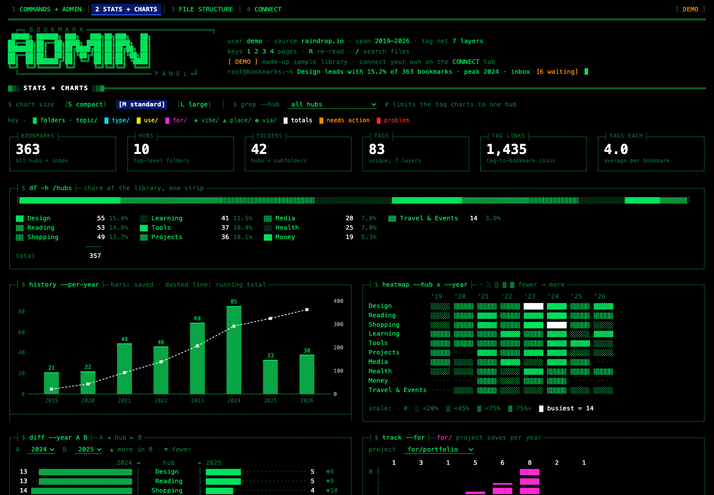
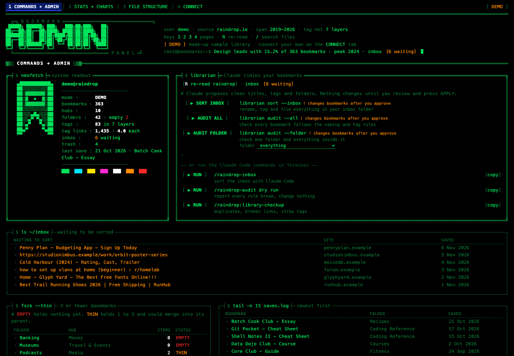
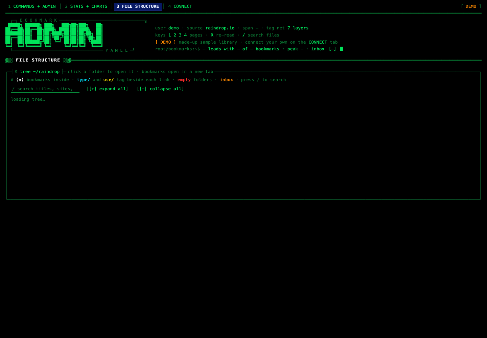
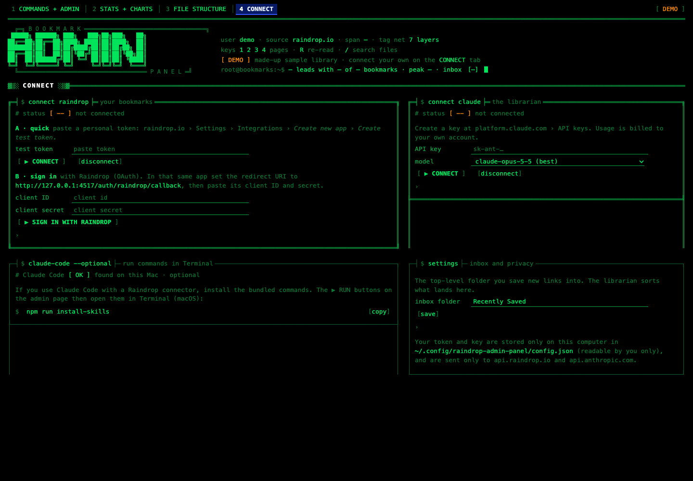

<p align="center">
  
</p>

```text
┌─┤ $ cat README.md ├──────────────────────────────────────────────────────────────┐
│                                                                                  │
│   RAINDROP BOOKMARK ADMIN PANEL                                                  │
│   A terminal-style dashboard for your Raindrop.io bookmarks.                     │
│   Charts, stats, a collapsible file tree, and Claude as your librarian:          │
│   it renames, tags and files new bookmarks for you. You approve every change.   │
│                                                                                  │
│   [ runs on your computer ]  [ your accounts ]  [ your keys never leave it ]     │
│                                                                                  │
└──────────────────────────────────────────────────────────────────────────────────┘
```

<p align="center">
  
</p>

> **Every screenshot shows the built-in demo library: made-up folders, titles and sites.**

---

## `$ whatis admin-panel`

```text
╔═╡ FEATURES ╞═════════════════════════════════════════════════════════════════════╗
║                                                                                   ║
║  [1] COMMANDS + ADMIN   system readout · inbox queue · folder health · recent     ║
║                         saves · the librarian (Claude) with preview → apply       ║
║                                                                                   ║
║  [2] STATS + CHARTS     hub share strip · saves per year · hub × year heatmap ·   ║
║                         folder treemap · year-vs-year diff · project tracker ·    ║
║                         tag waffle · lollipops · bars · S/M/L chart sizes         ║
║                                                                                   ║
║  [3] FILE STRUCTURE     every folder as a collapsible tree, bookmarks inside,     ║
║                         searchable, with type/ and use/ tags on each link         ║
║                                                                                   ║
║  [4] CONNECT            sign in to Raindrop · add your Claude API key ·           ║
║                         pick the inbox folder · optional Claude Code commands     ║
║                                                                                   ║
╚═══════════════════════════════════════════════════════════════════════════════════╝
```

| Commands + admin | File structure | Connect |
|:---:|:---:|:---:|
|  |  |  |

### The librarian

```text
root@bookmarks:~$ librarian sort --inbox

  › "Best Trail Running Shoes 2026 | Free Shipping | RunHub"
    → Trail Shoes - Running Gear - RunHub
      type/shop  use/buy  topic/fitness  for/run-club          → Health › Running

  › "how to set up vlans at home (beginner) : r/homelab"
    → Home VLAN Setup - Thread - Reddit
      type/forum  use/learn  topic/networking  for/home-lab  via/reddit
                                                              → Projects › Home Lab

  [ ▶ APPLY TICKED ]  [apply all]  [discard]
```

Save new links into one inbox folder (default **Recently Saved**). Press **SORT INBOX** and Claude proposes, for each one:

- **a clean title**, 2 to 4 parts: `Name - What it is - Source`
- **3 to 5 tags** from a 7-layer tag network, reusing the tags you already have
- **the best existing subfolder** to move it into

**AUDIT ALL** and **AUDIT FOLDER** check bookmarks you already have and flag only clear rule breaks: messy titles, missing or extra tags, bookmarks sitting loose in a top-level folder.

Nothing changes until you tick the rows you want and press **APPLY**. Every applied change is logged so it can be undone.

### The 7-layer tag network

```text
  type/   what the link IS      exactly 1   brand · tool · guide · wiki · forum · course …
  use/    WHY you saved it      exactly 1   buy · learn · research · reference · build …
  topic/  what it's ABOUT       1 – 2       web-dev · fonts · travel · fitness · film …
  for/    which PROJECT         optional    for/side-hustle · for/portfolio …
  vibe/   the AESTHETIC         optional    minimal · retro-tech · sci-fi · brutalist …
  place/  WHERE                 optional    uk · usa · japan · europe …
  via/    the PLATFORM          optional    reddit · youtube · wikipedia · github …
                                ─────────
                                3 – 5 tags per bookmark
```

### Colour key

Every colour means exactly one thing, everywhere in the panel:

```text
  ███ green    folders and topic/ tags        ███ white    totals and headline numbers
  ███ cyan     type/ tags                     ███ orange   needs action (inbox, thin folders)
  ███ yellow   use/ tags                      ███ red      problem (empty folders, errors)
  ███ magenta  for/ project tags              ███ blue     highlight and selection only
```

---

## `$ ./install.sh`

```text
┌─┤ REQUIREMENTS ├──────────────────────────────────────────────┐
│  › Node.js 20 or later                                        │
│  › a Raindrop.io account                                      │
│  › an Anthropic API key, for the librarian (optional)         │
│  › macOS + Xcode Command Line Tools, for the .app (optional)  │
└───────────────────────────────────────────────────────────────┘
```

```bash
git clone https://github.com/ajd1776/raindrop-bookmark-admin-panel
cd raindrop-bookmark-admin-panel
npm install
npm start
```

Then open **http://127.0.0.1:4517**. It opens in **DEMO** mode with a made-up library until you connect your own.

### Connect Raindrop (tab 4 › CONNECT)

**A · quick: a personal token**

1. Go to raindrop.io › **Settings › Integrations** and choose **Create new app**.
2. Open the app and press **Create test token**.
3. Paste the token into **test token** and press **CONNECT**.

**B · sign in with Raindrop (OAuth)**

1. In the same Raindrop app, set the **redirect URI** to `http://127.0.0.1:4517/auth/raindrop/callback`.
2. Paste the app's **client ID** and **client secret**.
3. Press **SIGN IN WITH RAINDROP** and approve access. Tokens refresh automatically.

### Connect Claude

1. Create an API key at [platform.claude.com › API keys](https://platform.claude.com/settings/keys).
2. Paste it into **API key**, pick a model and press **CONNECT**.

The librarian uses your own key, so usage is billed to your own Anthropic account. It defaults to `claude-opus-5-5`. Choose Sonnet or Haiku there to spend less.

### Optional: the Mac app

```bash
npm run app
```

This builds **Raindrop Admin Panel.app** in `~/Applications`. Opening it starts the server if it isn't already running, then shows the panel in its own window. Find it with ⌘ Space › "raindrop admin", or drag it to your Dock.

### Optional: Claude Code commands

If you use [Claude Code](https://claude.com/claude-code) with a Raindrop connector, install the bundled commands:

```bash
npm run install-skills
```

| command | what it does |
|---|---|
| `/raindrop-inbox` | sort the inbox: rename, tag and file |
| `/raindrop-inbox dry run` | preview only |
| `/raindrop-audit dry run` | report every bookmark that breaks the rules |
| `/raindrop-audit fix` | fix them, logging every change |

On macOS, the **▶ RUN** buttons on the admin page open these in Terminal.

---

## `$ cat /etc/privacy`

```text
╔═╡ WHERE YOUR DATA GOES ╞══════════════════════════════════════════════════════════╗
║                                                                                   ║
║  browser ──► 127.0.0.1:4517 (this app, on your machine)                           ║
║                    │                                                              ║
║                    ├──► api.raindrop.io    read bookmarks · write approved edits  ║
║                    └──► api.anthropic.com  titles, links and tags of the          ║
║                                            bookmarks being sorted (librarian only)║
║                                                                                   ║
╚═══════════════════════════════════════════════════════════════════════════════════╝
```

- **Where secrets are stored:** your Raindrop token and Claude key go in `~/.config/raindrop-admin-panel/config.json`, readable only by you (`chmod 600`). They are never sent to the browser, never logged and never committed.
- **Who can reach the server:** it listens on `127.0.0.1` only. It rejects requests addressed to any other host name, and every API call must carry a token that changes each time the server starts.
- **Undo log:** every applied change is written to `~/.config/raindrop-admin-panel/changes.jsonl`, with the old title, tags and folder.
- **Nothing is deleted:** the panel never deletes bookmarks or creates folders.

---

## `$ tree -L 2`

```text
raindrop-bookmark-admin-panel
├── server.js            local server: static files, API, OAuth, Terminal runner
├── lib/
│   ├── raindrop.js      Raindrop REST client (reads, paced writes, OAuth refresh)
│   ├── assistant.js     the librarian: Claude proposes titles, tags and folders
│   └── config.js        local settings store (chmod 600) and change log
├── public/
│   ├── index.html       the panel: 4 pages, ASCII frames, colour key
│   ├── js/              charts, demo data and the page runtime
│   └── vendor/d3.min.js
├── skills/              Claude Code commands: raindrop-inbox, raindrop-audit
├── macos/               Mac app launcher (Swift), icon and build script
└── docs/                banner and screenshots (demo data only)
```

### Built with

- **Server:** Node.js, with no web framework.
- **Claude:** the [Anthropic SDK](https://github.com/anthropics/anthropic-sdk-typescript), using structured JSON output.
- **Charts:** [d3](https://d3js.org) for the SVG charts. Everything else is drawn with text characters (`█▓▒░ ▁▂▃▅▇ ● ◆ ├── └──`).
- **Mac app:** a small Swift launcher.

---

```text
┌─┤ $ exit ├───────────────────────────────────────────────────────────────────────┐
│  MIT licensed · not affiliated with Raindrop.io or Anthropic                      │
└──────────────────────────────────────────────────────────────────────────────────┘
```
